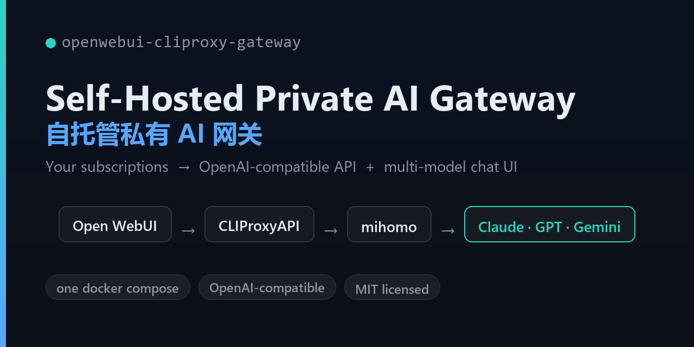

# Self-Hosted Private AI Gateway Kit

[](LICENSE)
[](docker-compose.yml)
[](https://github.com/zerbLion/openwebui-cliproxy-gateway/stargazers)
[](https://github.com/open-webui/open-webui)
[](https://github.com/router-for-me/CLIProxyAPI)



> 把你**订阅的** Claude / Codex(GPT)/ Gemini 等账号,变成一个**自托管、自用**的 OpenAI 兼容网关 + 多模型并排聊天前端。一份 `docker compose` 起全套。
>
> Turn your **own** Claude / Codex / Gemini subscriptions into a self-hosted,
> OpenAI-compatible gateway with a multi-model chat UI. One `docker compose` to run it all.

中文 ｜ [English below](#english)

---

## 这是什么

三个开源组件,被编排成一条闭环,**全部跑在你自己的机器上、用你自己的凭证**:

```
  浏览器 / 任意 OpenAI 兼容客户端
        │
        ▼
   Open WebUI ───────────────► CLIProxyAPI (:8317/v1)
   多模型并排前端                把订阅 OAuth 暴露成 /v1
        │                            │
        │                            ▼
        │                        mihomo  ──规则分流──► 国外 AI 上游
        │                        出站代理              (国内模型直连)
        ▼
   (可选) Cloudflare 隧道 → 公网入口 + 邮箱白名单
```

- **CLIProxyAPI**(模型来源):把 Claude / Codex / Gemini 的订阅登录态,统一成一个 OpenAI 兼容接口。
- **Open WebUI**(界面):多模型并排、合成单一答案(MoA)、数据全本地、手机 PWA。
- **mihomo**(网络):只让"调用国外 AI 那一跳"走代理,国内模型直连。
- **Cloudflare 隧道**(可选):给个公网地址,套邮箱白名单,出门也能用。

**它不是什么**:不是一个"用别人额度"的 API 中转站。它不含任何凭证;你接的是**你自己的订阅**。

---

## 截图 / Screenshots

> 多模型并排 + 合成单一答案(MoA)的实际界面(来自 Open WebUI)。
> _截图待补 —— 跑起来后把图放进 `docs/screenshots/`,取消下面注释即可。_
> _Screenshots coming — drop images into `docs/screenshots/` and uncomment below._

<!--  -->
<!--  -->

---

## 快速开始

前置:一台常开的机器(NAS / VPS / 旁路由皆可)+ Docker + Docker Compose。

```bash
git clone https://github.com/zerbLion/openwebui-cliproxy-gateway
cd openwebui-cliproxy-gateway

# 1) 配置
cp .env.example .env                                            # 改端口/密钥/域名
cp config/cliproxyapi/config.example.yaml config/cliproxyapi/config.yaml   # 填 key/mgmt 密钥
cp config/mihomo/config.example.yaml      config/mihomo/config.yaml        # 填你的代理节点

# 2) 起
./scripts/up.sh

# 3) 登录订阅(把 OAuth 登录态写进网关)
#    浏览器开 http://<host>:8317/management.html → 用 mgmt 密钥登录
#    → OAuth 登录 → 分别点 Claude / Codex / Gemini 登录

# 4) 验证
./scripts/status.sh         # 能列出模型 = OAuth 已通

# 5) 用
#    浏览器开 http://<host>:3000 建管理员账号,开始多模型并排聊天
```

起停:`./scripts/up.sh` · `./scripts/down.sh` · `./scripts/status.sh`

### 进一步

- 📕 [部署手册 / 故障排查 / 升级](docs/deploy.md) —— 前置、公网入口、系统级坑(inotify)、排错表
- 🔑 [凭证管理](docs/credentials.md) —— 怎么增 / 删 / 改订阅登录态,远程管理的安全做法

---

## 常见问题 FAQ

**Q:需要会员/订阅吗?**
A:需要。本项目**不提供任何额度**,接的是你自己的 Claude / Codex / Gemini 订阅(或 API key)。

**Q:海外服务器也要配代理(mihomo)吗?**
A:不用。海外机器直连国外上游,可把 mihomo 规则全设 `DIRECT`,或干脆不起 mihomo。代理只为"国内出国调用国外 API"那一跳。

**Q:能用国内模型吗(DeepSeek / 智谱 / Kimi / 通义)?**
A:能。国内模型直连,mihomo 规则里 `GEOIP,CN,DIRECT` 保证不走代理。

**Q:数据存在哪?会上传吗?**
A:全在你机器的挂载卷(`${DATA_ROOT}`),会话历史本地保存,不出本地。

**Q:手机能用吗?**
A:能。Open WebUI 是网页 + PWA,手机"添加到主屏"后近乎原生体验。

**Q:和直接填官方 API key 有什么区别?**
A:这里用的是**订阅 OAuth**(吃你的月费会员额度),不是按量计费的 API;并且能多家**并排**对比、合成答案。

**Q:Gemini 怎么接?**
A:用 **Antigravity OAuth**。老的 gemini-cli 个人版 OAuth 已被官方下线、且封禁第三方代理用法,别再用。

**Q:这合法吗 / 会封号吗?**
A:用订阅凭证反代成 API **可能违反对应服务商条款**,本项目不规避任何条款,**风险自负**,建议仅个人自托管自用。

---

## ⚠️ 须知 / Disclaimer

- 用订阅凭证反代成 API,**可能违反相应服务商的使用条款**。本套件不规避任何条款;**凭证与账号风险由你自负**。请仅用于个人自托管、自用场景。
- 本套件**不内置任何凭证 / 节点 / 密钥**。所有密钥请自行生成强随机值,且**永不提交到 git**(`.env` 与真实 `config.yaml` 已在 `.gitignore`)。

---

## 许可

套件自有代码(脚本 / compose / 模板 / 文档)= **MIT**。
内嵌的三个组件各自许可,见 [THIRD-PARTY-NOTICES.md](THIRD-PARTY-NOTICES.md)(本套件不打包它们,运行时拉官方镜像)。

---

## 贡献 / Contributing

欢迎 issue 和 PR —— bug 反馈、文档改进、更多上游的分流规则模板都很欢迎。详见 [CONTRIBUTING.md](CONTRIBUTING.md)。
Issues and PRs welcome — bug reports, docs, more upstream routing templates. See [CONTRIBUTING.md](CONTRIBUTING.md).

如果这个项目帮到你,点个 ⭐ 是最大的支持。 / If it helps you, a ⭐ is the best support.

---

<a name="english"></a>

## English

**What it is.** Three open-source components orchestrated into one loop, all running
**on your own machine with your own credentials**: CLIProxyAPI (exposes your
Claude/Codex/Gemini subscription OAuth as an OpenAI-compatible `/v1`), Open WebUI
(multi-model side-by-side chat UI), and mihomo (routes only the overseas-AI hop
through a proxy). Optional Cloudflare tunnel for a public entry with an email allowlist.

**What it is not.** Not a "use-someone-else's-quota" API reseller. It ships **no
credentials** — you connect **your own** subscriptions.

**Quick start.** See the Chinese section above; commands are language-neutral.
`cp .env.example .env`, copy the two `config/*.example.yaml`, fill in your keys and
proxy nodes, then `./scripts/up.sh`. Log in to your subscriptions at
`http://<host>:8317/management.html`, verify with `./scripts/status.sh`, and open the
UI at `http://<host>:3000`.

**Disclaimer.** Proxying subscription credentials as an API may violate the
respective providers' Terms of Service. This kit circumvents no terms; **credential
and account risk is yours**. For personal, self-hosted use only.

**License.** Kit's own code is **MIT**. Bundled components keep their own licenses
(see [THIRD-PARTY-NOTICES.md](THIRD-PARTY-NOTICES.md)); the kit pulls official images
rather than redistributing them.
